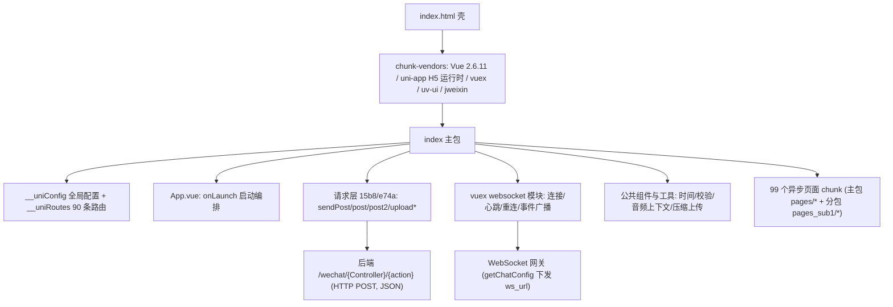

# H5 前端逆向分析说明书

> 目标站点：`https://bingren111.qjhw1.cn/h5/`（页面标题：游趣网络科技）
> 分析方式：纯静态分析（下载服务端下发的构建产物 → 反压缩/美化 → 结构化解读）
> 完成日期：2026-10-15

---

## 目录

1. [分析摘要](#1-分析摘要)
2. [分析方法、证据与局限性](#2-分析方法证据与局限性)
3. [技术栈与第三方依赖](#3-技术栈与第三方依赖)
4. [构建产物与资源加载机制](#4-构建产物与资源加载机制)
5. [运行时架构](#5-运行时架构)
6. [全局配置](#6-全局配置)
7. [页面与路由体系](#7-页面与路由体系)
8. [网络层设计](#8-网络层设计)
9. [登录与鉴权体系](#9-登录与鉴权体系)
10. [WebSocket 实时通讯体系](#10-websocket-实时通讯体系)
11. [业务模块详解](#11-业务模块详解)
12. [支付体系](#12-支付体系)
13. [后端接口全貌](#13-后端接口全貌)
14. [安全与工程观察](#14-安全与工程观察)
15. [附录](#15-附录)

---

## 1. 分析摘要

该站点是一个基于 **uni-app（Vue 2）编译为 H5** 的单页应用（SPA），业务形态是一个 **"陪玩/代练打手"撮合下单平台**：玩家（用户）在商城选购"打手"（陪玩服务者）的服务商品并下单支付，打手在"接单大厅"抢单、完成订单、接受客服（平台管理员/调度）的审核、罚款与打卡管理，同时平台带分销裂变、VIP、余额/保证金/提现、抽奖转盘、即时聊天（WebSocket）等完整闭环。

| 项目 | 值 | 依据 |
|---|---|---|
| 应用名称 | 游趣网络科技 | `__uniConfig.appName` |
| 应用 ID | `__UNI__1F1B05A` | `__uniConfig.appId` |
| 版本号 | 2.0.9（VersionCode 209） | `__uniConfig.appVersion` |
| 框架 | uni-app（编译器版本 5.07）+ Vue 2.6.11 | `__uniConfig` / vendors 内部版本串 |
| 目标平台 | h5（同时保留了 mp-weixin 小程序运行分支） | `__uniConfig.uniPlatform` |
| 路由模式 | hash 路由，base = `/h5/` | `__uniConfig.router` |
| 构建工具 | webpack 4 运行时（JSONP 异步 chunk 加载） | 运行时注入代码特征 |
| 入口资源 | 1 HTML + 2 JS + 1 CSS，另含 99 个按需异步 JS 分包 | index.html + chunk 映射表 |
| 后端接口 | 约 194 个，路径形如 `/wechat/{控制器}/{方法}` | 全量分包字符串提取 |
| 实时通讯 | WebSocket（由 `/wechat/Chat/getChatConfig` 下发 `ws_url`） | vuex `websocket` 模块 |

**架构一句话概括**：`index.html（壳）→ chunk-vendors（框架层：Vue/uni-app 运行时/uv-ui）→ index（主包：App 配置/路由表/工具库/请求层/公共组件）→ 99 个页面级异步 chunk（按 hash 路由懒加载）→ 通过统一 POST 请求层 + WebSocket 与 PHP 风格后端（`/wechat/控制器/方法`）交互`。

---

## 2. 分析方法、证据与局限性

### 2.1 方法与证据链

1. **入口抓取**：请求 `/h5` 得到 301 → `/h5/`，取得 `index.html`（801 字节，所有标签未加引号的最小化输出）。
2. **资源定位**：HTML 中仅引用两个 JS（`chunk-vendors.b607875f.js`、`index.bb23f40d.js`）与一个 CSS（`static/index.cc298949.css`）。
3. **分包发现**：在 `index.bb23f40d.js` 的 webpack 运行时中定位到「chunk 名称映射表」与「chunk 内容哈希映射表」两张 JSON 表，拼接出 `static/js/{名称}.{哈希}.js` 的完整 URL，共 **99 个异步分包**，全部下载成功（共约 3.8 MB）。
4. **反压缩（"反编译"）**：使用 prettier（babel 解析器）将全部 JS 反格式化为可读代码（产物见 [h5-源码/beautified](computer:///workspace/h5-源码/beautified)）。
5. **结构化提取**：从美化产物中提取路由表、接口清单、请求封装、vuex 模块、支付流程、WebSocket 协议、第三方库指纹等。

### 2.2 局限性（务必阅读）

- 本说明书全部结论来自**静态代码阅读**，未实际运行该应用、未登录、未调用其任何后端接口。
- 后端实现、数据库、接口真实行为、返回体中 `status` 的完整语义均为**推断**，以服务端实际为准。
- 压缩后变量名丢失，个别页面逻辑为抽样核对而非逐行通读；可能存在个别页面未覆盖到的细节。
- 站点可能随版本更新变化，本说明书对应**分析时刻**的线上版本（资源哈希见附录 C）。

### 2.3 观察与推断的标注约定

- 【观察】直接来自代码/HTTP 响应的事实；
- 【推断】基于代码特征的合理推测；
- 【未知】无法用现有证据回答的问题。

---

## 3. 技术栈与第三方依赖

### 3.1 框架层

| 组件 | 版本/证据 | 角色 |
|---|---|---|
| uni-app 编译产物 | `compilerVersion: "5.07"` | 整体框架，`uni.*` API 垫片、Page 包装器、`__uniConfig/__uniRoutes` 注入 |
| Vue | 2.6.11 | 视图层（vendors 内出现 `"2.6.11"` 版本串）【观察】 |
| vuex | 未单独取证版本 | 状态管理（含 namespaced 的 `websocket` 模块） |
| vue-router（uni 内建路由） | — | hash 模式路由由 uni-app 运行时接管 |
| webpack 4 | JSONP chunk loader、模块 ID 为短 hash 字符串 | 模块打包与懒加载 |

### 3.2 UI 与工具库

- **uv-ui（uview 的 Vue2 兼容分支）**：代码中大量出现 `uv-tabs`、`uv-swiper`、`uv-popup`、`uv-icon`、`uv-form`、`uv-tabbar`、`uv-loading-icon`、`uv-overlay`、`uv-transition`、`uv-search`、`uv-badge`、`uv-empty`、`uv-loadmore` 等组件类名与 `uni.$uv.toast / uni.$uv.throttle` 全局工具。【观察】
- **jweixin（微信 JS-SDK 封装）**：`wx.config / wx.ready / wx.chooseWXPay / wx.updateAppMessageShareData`。
- **WeixinJSBridge**：启动即注入 `setFontSizeCallback` 锁定微信字号（防止用户调大字体破坏布局）。
- **无 jQuery/Bootstrap 等传统库**；未发现图表库、地图 SDK（`qqMapKey/aMapKey` 均为 `void 0`）。

### 3.3 后端形态【推断】

接口路径为 `/wechat/{控制器}/{方法}` 双段驼峰命名（如 `/wechat/Goods/getGoodsList`），是典型的 **ThinkPHP 类 MVC 控制器-操作** 路由风格；前端请求体携带 `token/platform/system_type`，服务端以 JSON `{status, msg, data, auth_url}` 统一应答。

---

## 4. 构建产物与资源加载机制

### 4.1 入口 HTML（观察）

```html
<!-- 结构还原（非逐字引用） -->
<html lang=zh-CN>
  <head>
    <meta charset=utf-8> <title>游趣网络科技</title>
    <script> /* CSS env() 支持侦测后动态输出 viewport-fit=cover 的 viewport */ </script>
    <link rel=stylesheet href=/h5/static/index.cc298949.css>
  </head>
  <body>
    <noscript>Please enable JavaScript to continue.</noscript>
    <div id=app></div>
    <script src=/h5/static/js/chunk-vendors.b607875f.js></script>
    <script src=/h5/static/js/index.bb23f40d.js></script>
  </body>
</html>
```

### 4.2 资源清单

| 资源 | 大小 | 内容 |
|---|---|---|
| `chunk-vendors.b607875f.js` | ≈855 KB（美化后 56,135 行） | Vue、uni-app H5 运行时、vuex、uv-ui、jweixin 等第三方库 |
| `index.bb23f40d.js` | ≈289 KB（美化后 14,250 行） | 主包：`__uniConfig`、路由表、App.vue、请求层、公共组件、工具库、websocket 模块 |
| `index.cc298949.css` | ≈97 KB | 全站样式（含 uv-ui 样式与 uni-app 内置变量注释） |
| 异步页面 chunk ×99 | ≈3.8 MB | 页面组件与共享页面依赖（`pages-*` / `pages_sub1-*` 前缀） |

### 4.3 加载机制【观察】

- webpack `publicPath = "/h5/"`；异步 chunk 命名 `{页面组名~...}.{8位哈希}.js`，`<script>` 注入 + 120s 超时，加载失败触发 `t.oe` 错误回调。
- 每个页面通过 `Vue.component("pages-xxx", () => Promise.all([预加载依赖 chunk]).then(取模块))` 注册——**进入页面前会并行预取该页共享的多个依赖 chunk**（如首页会预取 4 个 chunk）。
- `preloadRule`: `"pages/index/index": { network: "all", packages: ["pages_sub1"] }`——打开首页即在任意网络下预下载 `pages_sub1` 分包（订单/接单/客服等核心流程页），减少后续跳转白屏。

### 4.4 CDN 与网络路径【观察】

- 响应头含 `X-NWS-LOG-UUID`、`X-Cache-Lookup`，为腾讯云 CDN/边缘加速特征；`Server: nginx`。
- HTTPS 请求返回 `301` 且 `Location` 指向 **`http://`** 明文地址（同时带 `Strict-Transport-Security` 头），配置存在矛盾点，详见 §14。

---

## 5. 运行时架构

### 5.1 分层结构（自上而下）



### 5.2 启动流程（App.onLaunch 编排）【观察】

`onLaunch` 依次执行：

1. `uni.hideTabBar()` —— 隐藏原生 tabBar（页面内自绘 uv-tabbar/自定义底栏，tabBar 配置仅用于页面标记）；
2. `getQueryToken()` —— 解析 **URL hash 中的 `?token=`** 并直接写入 storage（供分享/小程序跳转携登录态进入）；
3. `uni.setStorageSync("enter_system_notice", 0)` —— 重置系统公告弹窗标记；
4. `checkWeappUpdate()` —— 空函数（预留）；
5. `dispatch("websocket/connect", 启动query)` —— 拉取聊天配置并建立 WebSocket；
6. `initAudioCtx()` —— 创建全局 `InnerAudioContext`（循环、不自动播放），挂到 `uni.$audioCtx`，并广播 `audioPlayStateChange` 事件（新消息提示音体系）。

### 5.3 页面渲染机制

uni-app 把每个页面编译为 `Vue.component("pages-x-x", 异步加载器)`，路由命中时由通用 `Page` 包装组件注入页面属性（`isQuit/isTabBar/tabBarIndex/navigationBarTitleText` 等），页面组件再以 `<pages-x-x slot="page">` 渲染；异步加载期间显示 `SystemAsyncLoading`，失败显示 `SystemAsyncError`。

---

## 6. 全局配置

以下均为 `__uniConfig` 中的【观察】值：

| 配置项 | 值 |
|---|---|
| `globalStyle` | 导航栏白底黑字、背景 #fff、`rpxCalcMaxDeviceWidth: 0` |
| `tabBar.list`（被 hideTabBar 隐藏，仅作标记） | 首页 `pages/index/index`、分类 `pages/cat/index`、达人 `pages/index/daren`、客服 `pages/chat/list`、我的 `pages/user/index` |
| `router` | `{ mode: "hash", base: "/h5/" }` |
| `publicPath` | `/h5/` |
| `darkmode / themeConfig` | 关闭 / 空 |
| `nvue.flex-direction` | column（H5 下无实际作用） |
| `sdkConfigs / 地图 key` | 全部为空 |

---

## 7. 页面与路由体系

共 **90 条路由**（含 1 条 `/` 别名）。命名空间分为两包：主包 `pages/*` 与分包 `pages_sub1/*`（H5 下仅影响 chunk 分组与预载策略）。

### 7.1 主包页面（pages/）

**商城与内容**
| 路由 | 标题 | 说明【推断依据页面名与接口】 |
|---|---|---|
| `/pages/index/index` | 首页（入口，tab 0） | 轮播+导航+商品流+订单弹幕+公告 |
| `/pages/cat/index` `/pages/cat/index2` | 分类（tab 1） | 两种分类布局 |
| `/pages/cat/list` | 商品列表 | 分类下商品分页 |
| `/pages/index/goods` `/pages/active/goods` | 商品详情 | 普通/活动(抽奖)两种详情 |
| `/pages/index/search` | 搜索 | getSearchList |
| `/pages/index/daren` `/pages/index/seller` | 达人列表 / 达人详情 | 打手展示、评分、评论 |
| `/pages/follow/index` | 关注 | 关注的打手 |

**交易**
| 路由 | 标题 |
|---|---|
| `/pages/pay/submit` `/pages/pay/raffle` | 提交订单 / 抽奖下单 |
| `/pages/pay/index` | 收银台 |
| `/pages/pay/recharge` `/pages/pay/deposit` `/pages/pay/vip` | 余额充值 / 保证金 / VIP |
| `/pages/pay/check_result` `/pages/pay/success` | 支付校验 / 成功 |
| `/pages/alipay/index` `/pages/alipay/paid` | 支付宝跳转 / 回跳提示 |
| `/pages/active/order` `/pages/active/turntable` | 我的抽奖 / 幸运大转盘 |

**用户与资产**
| 路由 | 标题 |
|---|---|
| `/pages/user/index` | 个人中心（tab 4，下拉刷新） |
| `/pages/user/login` `/pages/user/login_old` | 授权登录 / 手机号登录 |
| `/pages/user/bind_mobile` `/pages/user/bind_mobile_weapp` | 绑定手机号 / 小程序快捷手机号 |
| `/pages/user/personal` `/pages/user/certification` `/pages/user/huifu` | 个人资料 / 实名认证 / 汇付收款信息 |
| `/pages/user/apply` `/pages/user/level` | 申请成为陪玩 / 等级详情 |
| `/pages/user/withdraw` `/pages/user/withdraw_log` | 申请提现 / 提现记录 |
| `/pages/user/money_log` `/pages/user/order_log` | 余额记录 / 冻结记录 |
| `/pages/user/deposit_withdraw` `/pages/user/fine_list` | 保证金 / 罚款列表 |
| `/pages/user/article` | 文章详情 |
| `/pages/agent/index` `/pages/agent/child` `/pages/agent/score_log` `/pages/agent/cash_score` `/pages/agent/cash_score_log` | 分销中心 / 邀请列表 / 佣金记录 / 佣金提现 / 佣金提现记录 |

**状态与其他**
| 路由 | 标题 |
|---|---|
| `/pages/index/incomer` `/pages/index/unauth` `/pages/index/error` | 温馨提示(status 4) / 未授权(status 5) / 错误(40016) |
| `/pages/index/agree` | 隐私提示 |
| `/pages/chat/list` | 聊天列表（tab 3，用户↔客服入口） |
| `/pages/system/index` | "同款搭建指引"（平台销售/引流页） |

### 7.2 分包页面（pages_sub1/）

**订单侧（用户）**：`order/index` 订单列表、`order/info` 订单详情、`order/comment` 评价、`order/service` 售后、`order/audit_list` `order/audit_detail` 审核单、`order/invite_fupei` 邀请副陪、`order/seller` `order/seller_info`（打手视角订单）、`order/seller_service` 打手售后。

**接单侧（打手）**：`seller/index` 打手中心、`seller/hall` `seller/hall_info` 接单大厅与抢单详情、`seller/rank` 排行榜、`seller/invited` 受邀订单、`seller/seller_pay` 开通接单权限、`seller/edit_profile` 编辑资料、`seller/message` 订阅消息授权、`seller/notice` `seller/notice_detail` 平台通知（含强制公告确认）。

**客服侧（平台工作人员）**：`chat/index` 客服工作台(PC式)、`chat/info` 聊天、`chat/notice` 系统通知、`chat/history` 聊天记录、`kefu/order` 订单列表、`kefu/info` 订单详情、`kefu/audit` `kefu/audit_detail` 审核、`kefu/service` 售后处理、`kefu/total` 单量统计、`kefu/daka` 打卡、`kefu/fine_*` 罚款管理(列表/添加/编辑/详情)。

**其他**：`active/lucky_draw` 幸运大转盘、`chat/test` `kefu/test`（测试页残留）。

---

## 8. 网络层设计

### 8.1 基础设施（模块 `15b8`）【观察】

- **baseUrl**：取 `location.origin`；若主机名为 `localhost` 则回退为 **`https://xiaocho.qiangshenyiyou.cn`**（后端真实域名硬编码在前端）。
- **统一 POST**：所有业务请求都用 `uni.request` + `method: POST`、JSON body；URL = baseUrl + 相对路径。
- **上传族**：`uploadImg / uploadImgs`（字段名 `img`）、`uploadFile`（字段名 `file`，带进度回调）；`uploadCompressImgs` 用 canvas 把图片最长边压到 1500px、JPEG 0.8 质量后走 Base64 上传（`/wechat/Files/uploadBase64`）。
- **debug 开关**：`dubug = (location.hostname == "localhost")`；为真时请求体 token 强制为固定值 `"Hns8jk2njsk"`（本地调试后门）。

### 8.2 业务请求封装（模块 `e74a`）【观察】

三个出口，均自动附加 `platform: "h5"` 与 `system_type: uni.getSystemInfoSync().platform`：

| 封装 | token | 统一错误处理 |
|---|---|---|
| `send` / `post`（send 是 post 的 promise 包装） | 从 storage 读，写入 body 字段 `token` | 见下方状态机 |
| `post2` | 不带 token | 仅 status==4 跳 `/pages/other/incomer` |

**响应状态机**（响应 HTTP 200 后按业务 `status` 分流）：

| status | 行为 | 语义【推断】 |
|---|---|---|
| 1 | resolve 交给页面 | 成功 |
| 3 | 清空 token、把 `auth_url` 存 storage、toast"请先登录"→ 非微信浏览器跳 `/pages/user/login_old`（手机号登录），微信内浏览器 1 秒后携 `back_url`（当前页）与 `share_code` 跳转 `auth_url`（微信 OAuth 授权域） | 未登录/登录态失效 |
| 4 | `reLaunch /pages/index/incomer` | 账号受限/风控提示页 |
| 5 | `reLaunch /pages/index/unauth` | 无权限页 |
| 40016 | `reLaunch /pages/index/error` | 全局错误页 |
| 其他 | `showToast(msg)` 后照常 resolve（调用方可继续处理） | 业务失败 |

防重复提交：关键按钮用 `uni.$uv.throttle(fn, 1500)`；过程用 `showLoading("请求中/正在加载..")`。

### 8.3 调用习惯

- 页面几乎都在 `onLoad/onShow` 中 `send(url, params, showToast开关)`；
- 参数序列化、时间格式化等工具方法内联在主包（未发现独立请求签名/加密层）【观察】。

---

## 9. 登录与鉴权体系

### 9.1 登录态载体

- `token` 明文存于 `uni storage`（H5 下即 localStorage），请求时写入 **body**（非 Authorization 头）。
- URL hash 携带 `?token=` 可直接注入登录态（App 启动读取）；小程序 web-view 跳 H5 收银台时即用此方式传 token【观察】。
- `share_code` 邀请码：贯穿 URL → storage → 登录/OAuth 参数，用于分销绑定上下级。

### 9.2 三条登录路径

1. **微信 OAuth（默认，微信内浏览器）**
   `/wechat/User/getLoginInfo` 获取配置 → 前端拼 `https://open.weixin.qq.com/connect/oauth2/authorize?...response_type=code&scope=snsapi_userinfo&state=123&redirect_uri=...` → 回跳页 `getUrlCode` 取 code → `/wechat/User/loginUser {code, share_code}` 换 token。授权域名来自服务端下发的 `auth_url`（status 3 时下发并缓存）。
2. **手机号验证码（非微信浏览器 → login_old）**
   图形验证码 `/wechat/User/getCaptchaCode`（配合 `uv-` 验证码输入组件）→ 短信 `/wechat/MsgCode/sendCode` → `/wechat/User/bindUserMobile` / 登录提交。
3. **微信小程序路径（保留代码，H5 不触发）**
   `weappLogin`: `uni.login` 取 code → `/wechat/WeappUser/login {code, brand, system, version, model, share_code}`；含 `deadline_status`（小程序到期弹窗退出）与 `debug_status`（维护中弹窗）两个运营开关；快捷手机号 `/wechat/WeappUser/getWeappUserMobile`。

### 9.3 会话维持

无 refresh token 机制【观察】；token 失效统一由 §8.2 状态机处理（status 3 → 重新授权）。`checkUserLoginStatus` 接口供活动页校验登录态。

---

## 10. WebSocket 实时通讯体系

vuex namespaced 模块 `websocket`（主包内置）【观察】：

```
connect(query) ──► POST /wechat/Chat/getChatConfig {kefu_token}
              ◄── data.ws_url
init_socket ──► uni.connectSocket(ws_url)
onOpen   ──► isConnected=true, 启动心跳, $emit("websocket_connected")
onMessage ─► JSON.parse → {label,...}
              ├─ label=="init": 若 payload.kefu 为空 → POST /wechat/ChatClient/bindUser {client_id, user_id}
              │                  否则(客服端)      → POST /wechat/ChatClient/bindKefu {client_id, kefu.user_id}
              └─ 其余: state.message=消息, $emit("websocket_message", 消息)
心跳: 每 50s 发送 {label:"ping"}; 若距 lastActiveTime > 2×间隔 → 主动 close(code 1000 "心跳超时")
重连: 指数退避 1s→2s→4s...上限 30s, 最多 5 次; checkConnection 5s 内无响应强制重连
onError/onClose → 停心跳 → tryReconnect → $emit("websocket_error"/"websocket_closed")
发送: send_message → socket.send(JSON.stringify(对象))
```

**消费方**（`uni.$on("websocket_message")`）：`pages/chat/list`（用户聊天列表）、`pages_sub1/chat/info`（聊天页：文本/图片 checkImgMsg/语音 downloadVoice/转接 transToTa/聊天记录分页 getChatLogMorePage）、`pages_sub1/chat/index`（客服工作台：pcKefuSelectChat/pcSendKefuMsg/pcTransToTa/lookOrder/在线客服列表）。

**配套接口**：`matchKefu1/2`（用户匹配客服）、`matchSeller1/2`、`matchUser1/2`（订单会话匹配）、`ChatWithOrder/getMobileChatList`、`Chat/endChat`、`Wechat/getAudioConfig`（微信语音 SDK 配置）、`Chat/getMobileChatCenter`、`ChatPc/changePcKefuStatus/endPcChat/getPcKefuChatInfo/getPcKefuLogList/getPcOnlineKefuList`。

【推断】后端为 GatewayWorker/Workerman 类长连接网关：先 HTTP 拿 ws_url，连接后网关下发 `client_id`，再由业务接口把 client_id 与 user_id 绑定——这是 Workerman 经典的 "init + bind" 模式。

---

## 11. 业务模块详解

> 接口计数依据附录 B 全量清单；行为描述来自页面代码调用关系【观察】+ 业务语义【推断】。

### 11.1 首页与内容分发
- `Home/getHomeInfo`：首页聚合数据（轮播/金刚区/推荐等）。
- `Wechat/getNavList {label:1}`：导航分类。
- `Goods/getGoodsList`：首页商品流；`getOrderDanmu`：订单弹幕（营造下单氛围）。
- `Wechat/getShareSignPackage`：JS-SDK 签名 → `wx.updateAppMessageShareData` 自定义分享卡片。
- `Article/closeNotice` / `Notice*`：公告弹窗与已读回执；`Index/getTipsInfo`：incomer 提示页文案。

### 11.2 商城（分类/搜索/商品）
- 分类：`Cat/getCatList、getCatList2、getCatListById、getCatListByLevel1`；两种分类页（index/index2）与商品列表页 `Goods/getCatGoodsList/getGoodsListInCat/getChildGoodsList`。
- 搜索：`Goods/getSearchList`。
- 详情：`Goods/getGoodsInfo`（含规格 `Wechat/getSpecConfig`）、评价 `Goods/getGoodsCommentList`、语音介绍 `Wechat/getAudioConfig`。
- 达人体系：`Daren/getDarenGroupList/getTagList`（列表页筛选）、`getDarenInfo/getDarenGoodsList/getDarenCommentList/getSellerStarInfo`（详情页/星级）。
- 关注：`UserFans/followSeller、getFollowList`。

### 11.3 订单主流程（用户）
1. 详情页选规格 → `Goods/getSubmitInfo`（下单页数据，含 `Seller/getWorkerList` 选指定打手）；
2. 提交 → 收银台（见 §12）；
3. 订单管理：`Order/getOrderList/getOrderInfo`；`userCancleOrder` 取消；`endOrder` 结束；`addComment/getCommentInfo` 评价；
4. 异常：`problemOrder` 问题单、`getOrderLog/getOrderOperationLog` 订单与操作日志、`changeIosVituralPayAlert` iOS 虚拟支付提示开关；
5. 售后：`OrderService/applyService` 申请、`getServiceInfo` 进度、`applyKefu` 申请平台介入。

### 11.4 接单大厅（打手）
- `Order/getHallCatInfo/getHallList/getHallInfo`：大厅分类与待抢订单；
- **抢单**：`Order/startOrder {id}` → `Order/getRobResult` 轮询抢单结果；
- **滑块验证码防机器人**：抢单前 `OrderCaptcha/getSliderOptions` 拉取拼图参数 → 用户拖动 → `OrderCaptcha/checkSlider` 校验通过才放行 startOrder【观察】；
- 副陪（多人单）：`OrderMember/addOrderMember` 邀请副陪、`verifyInvite` 受邀校验、`editMemberWorker/delMemberWorker` 管理成员、`order/invite_fupei` 与 `seller/invited` 两侧页面；
- 打手视角订单：`Order/getSellerOrderList/getSellerOrderInfo`、`confirmOrder` 确认、`sellerCancleOrder`、`auditResubmit` 重新提交审核、`OrderService/getSellerServiceInfo/vertifyService` 售后。

### 11.5 打手中心（服务者管理）
- 入驻：`Seller/applySeller`（含 Base64 图片上传 `Files/uploadBase64`）、`getApplyInfo` 查进度；
- 经营：`getCenterInfo` 中心数据、`changeOnlineStatus` 上下线、`getHallOrderNum` 大厅单量、`SellerNotice/*` 平台通知（`checkForceNotice` 强制弹窗、`confirmNotice` 确认已读、`getUnreadCount` 红点）；
- 开通接单权限（付费）：`SellerOrder/getSellerOrderInfo/getPayInfo` → 复用收银台 → `queryPayStatus` 轮询；
- 订阅消息：`getSellerMsg` + `addWeappMsgNum`（小程序订阅次数）；
- 排行榜：`getRankInfo`；资料：`getEditProfile/saveEditProfile`。

### 11.6 客服/风控体系（平台调度）
- 工作台：`ChatPc/*`（PC 网页式接单会话）+ `Chat/*`（移动端），订单会话中可直接 `ChatPc/lookOrder` 查看订单、`pcTransToTa/transToTa` 转接；
- 审核：`Kefu/getAuditList/getAuditDetail/getAuditConfig`，`auditPass/auditReject`（订单完成凭证审核）、用户侧对应 `Order/getSellerAuditList/getSellerAuditDetail`；
- 订单干预：`Kefu/cancelOrder/resetOrder/verifyProblem/vertifyService`；
- **打卡（考勤）**：`KefuDate/getCardInfo/addCard/endCard/getKefuDateInfo/getKefuDateLog`；
- **罚款**：`KefuFine/getFineList/getFineDetail/addFine/editFine/delFine/getSellerList`，用户侧 `UserBzj/getFineList` 与 `/pages/user/fine_list`；
- 统计：`kefu/total`（`getKefuDateInfo/getKefuDateLog` 单量总和）。

### 11.7 资金与分销
- **提现**：`CashOut/getCashOutInfo/applyCashOut/getCashOutLog`（余额提现）与 `CashScore/applyCashScore/getCashScoreInfo`（佣金提现）+ `agent/cash_score*` 页面；
- **保证金**：`UserBzj/getSellerBzjInfo/applyBzjCashOut/getLogList`（充值走 `RechargeConfig/getSellerRechargeInfo`）；
- **余额流水**：`UserMoney/getLogList`；冻结记录复用 `Order/getOrderLog`；
- **分销裂变**：`Agent/getAgentInfo`（分销中心）、`getSharePoster`（生成邀请海报）、`getShareLog`（邀请列表）、`UserScore/getLogList`（佣金明细）；分享链路带 `share_code` 完成绑定（§9）；
- **VIP**：`Vip/getVipList`；**等级**：`UserLevel/getUserLevelIntro`。

### 11.8 实名与收款
- 实名：`UserReal/getRealInfo/saveRealInfo`（`pages/user/certification`）；
- 收款账户：`HuifuAccount/saveHuifuAccount/getHuifuRealInfo`——接入**汇付天下**做收款/分账【推断，依据控制器与页面名"汇付收款信息"】。

### 11.9 营销活动
- **幸运大转盘**：`Raffle/getRaffleStyle/getGoodsInfo/getChildRaffleList/getSubmitInfo/getRaffleCommentList`（奖品与下单）、`RaffleOrder/addRaffleOrder/getRaffleOrder/getRaffleOrderList/getRaffleNews`（抽奖、中奖播报）；
- 活动goods与普通goods双详情页（`pages/active/goods`、`pages/pay/raffle` 下单、`pages/active/turntable` 转盘）。

### 11.10 其他
- `Weapp/getWeappInfo`：隐私协议/应用信息（agree 页）；
- `pages/system/index`："同款搭建指引"页（`Wechat/getSysDjConfig`）——该平台同时对外售卖同款系统【观察+推断】；
- 残留测试页 `chat/test`、`kefu/test` 与接口 `Cat/getCatList23`（疑似开发遗留）。

---

## 12. 支付体系

### 12.1 收银台（pages/pay/index）【观察】

`getPayInfo {type, id, submit}` 返回 `payType 列表 / show_alipay / pay_deadline(60s 倒计时) / order_black / price / money`。设备识别：`devtools` 环境下按 UA 修正 ios/android，并打印"收银台设备环境"日志。

**pay_type 路由表**（提交后按渠道分发）：

| pay_type | 渠道 | 前端实现 |
|---|---|---|
| 1 / 5 | 微信支付 | 微信内：`Wechat/getSignPackage`（传当前页 # 前地址）→ `wx.config(jsApiList:["chooseWXPay"])` → `Pay/pay` 下单 → `wx.chooseWXPay`；小程序 web-view 内：`wx.miniProgram.navigateTo` 跳小程序收银台（URL hash 带 token/id/type/pay_type/submit）；小程序端：`uni.requestPayment` |
| 2 / 6 | 支付宝 | 跳 `/pages/alipay/index?pay_type=...`，`Pay/pay` 后 `Pay/queryOrderStatus` 轮询；`show_alipay=0` 时从支付方式列表剔除"支付宝" |
| 3 | 余额 | 直接 `Pay/pay` 扣款 |
| 4 | iOS 虚拟支付 | `uni.requestVirtualPayment(signData/mode/paySig/signature)` + `PayHandle/queryVituralOrderStatus` 轮询 |
| 7 / 8 | 易支付(yiPay) | `yiPay` 方法第三方跳转；回跳带 `epay_back` 时用 `last_epay_order_no` 自动续查（`epayAutoQuery`） |

其他细节：`pay_debug` 为真时跳过拉起支付直接 toast"支付成功"（联调开关）；支付超时 `pay_deadline` 倒计时；`order_black` 疑似黑名单/限制下单标记【推断】。

### 12.2 周边支付页

- 充值：`RechargeConfig/getRechargeInfo`；保证金：`getSellerRechargeInfo`；
- VIP/接单权限/抽奖均复用同一收银台（type/id 参数区分）；
- `/pages/pay/success` 用 `Pay/queryOrderJumpPath` 决定跳转；`/pages/alipay/paid` 提示"支付完成请手动返回微信"。

---

## 13. 后端接口全貌

共提取 **194 个接口字符串，归属 45 个控制器**。完整清单（含来源 chunk）见 [h5-源码/api_endpoints.txt](computer:///workspace/h5-源码/api_endpoints.txt)。控制器分布：

| 控制器 | 数量 | 控制器 | 数量 | 控制器 | 数量 |
|---|---|---|---|---|---|
| Order | 27 | Kefu | 13 | Chat | 11 |
| User | 10 | ChatPc | 10 | Wechat | 8 |
| Goods | 7 | OrderService | 6 | Daren | 6 |
| KefuFine | 6 | Raffle | 5 | OrderMember | 5 |
| SellerNotice | 5 | Seller | 12 | RaffleOrder | 4 |
| KefuDate | 4 | UserBzj | 4 | Pay | 4 |
| Cat | 4 | ChatLog | 4 | CashOut | 3 |
| Agent | 3 | SellerOrder | 3 | CashScore | 2 |
| Files | 1 | Home | 2 | HuifuAccount | 2 |
| Notice/NoticeLog | 1+1 | OrderCaptcha | 2 | PayHandle | 1 |
| RechargeConfig | 2 | UserFans | 2 | UserReal | 2 |
| UserLevel/UserMoney/UserScore/Vip/Weapp/WeappUser/MsgCode/Index/ChatWithOrder/Article | 各 1 | | | |

命名规律【观察】：查询以 `get*` 开头、写操作以动词开头（`add*/edit*/del*/apply*/save*/bind*/change*/confirm*/start*/end*/audit*/reset*/check*/upload*`）；全部 POST。

---

## 14. 安全与工程观察

> 以下均为静态代码观察与基于观察的推断，仅供该平台开发者/所有者自查改进；不代表对系统的任何测试结论。

**鉴权与凭据**
1. 【观察】token 明文存 localStorage 且走请求体（非 HttpOnly Cookie/Authorization 头），XSS 场景下面临凭据窃取风险；URL hash 传 token 会被浏览器历史/分享链接携带。
2. 【观察】本地调试后门：`localhost` 域名下 token 固定为 `Hns8jk2njsk`，属硬编码共享凭据。
3. 【观察】前端硬编码生产后端域名 `xiaocho.qiangshenyiyou.cn`。

**传输与站点配置**
4. 【观察】HTTPS 请求 301 → `http://` 明文地址（同时返回 HSTS 头），存在协议降级/明文暴露窗口，建议 301 指向 https。
5. 【观察】未发现 CSP；控制台大量 `console.log` 输出业务数据（含 websocket 消息、设备信息）。

**接口面**
6. 【观察】前端可见全部 194 个接口路径与参数结构，无请求签名/加密层；防刷依赖滑块验证码（抢单场景）与服务端约束【推断】。
7. 【观察】状态机中 `status=3` 依赖前端跳转登录，接口本身未观察到前端侧的权限粒度控制——权限必须完全由后端保证【推断】。

**工程卫生**
8. 【观察】测试页（`chat/test`、`kefu/test`）与调试接口（`getCatList23`）残留在生产包。
9. 【观察】`pay_debug`、`dubug` 等开关逻辑进入生产包，虽有域名条件保护，但属高风险开关。
10. 【观察】主包内保留完整 mp-weixin 运行分支（weappLogin/virtualPay 等），属多端复用代码，非异常。

---

## 15. 附录

### 附录 A：交付物清单

| 路径 | 内容 |
|---|---|
| [h5-说明书.md](computer:///workspace/h5-说明书.md) | 本说明书 |
| [h5-源码/original/index.html](computer:///workspace/h5-源码/original/index.html) | 线上原始入口 HTML |
| [h5-源码/original/](computer:///workspace/h5-源码/original) | 线上原始（未格式化）JS 与 CSS |
| [h5-源码/beautified/index.js](computer:///workspace/h5-源码/beautified/index.js) | 主包反压缩源码（14,250 行） |
| [h5-源码/beautified/chunk-vendors.js](computer:///workspace/h5-源码/beautified/chunk-vendors.js) | 第三方库反压缩源码（56,135 行） |
| [h5-源码/beautified/pages/](computer:///workspace/h5-源码/beautified/pages) | 99 个页面分包反压缩源码 |
| [h5-源码/api_endpoints.txt](computer:///workspace/h5-源码/api_endpoints.txt) | 194 个接口路径与来源文件对照 |
| [h5-源码/chunks.txt](computer:///workspace/h5-源码/chunks.txt) | 全部异步 chunk 的 URL 路径 |

### 附录 B：状态码与协议速查

- 业务响应：`{status, msg, data, auth_url?}`；status ∈ {1 成功, 3 未登录, 4 受限→incomer, 5 无权→unauth, 40016 →error}【观察，语义为推断】。
- WebSocket 消息：`{label: "init"|"ping"|业务label, ...}`；init 携带 `client_id`。
- 请求公共字段：`token`（除 post2）、`platform: "h5"`、`system_type`。

### 附录 C：分析时刻的资源指纹

- 入口：`/h5/`（chunk-vendors.b607875f.js / index.bb23f40d.js / index.cc298949.css）
- 异步 chunk：99 个（清单见 chunks.txt）
- 版本：appVersion 2.0.9 / VersionCode 209 / compiler 5.07

### 附录 D：复现分析步骤

1. `curl -L https://bingren111.qjhw1.cn/h5/ -o index.html`；
2. 从 `index.bb23f40d.js` 中提取 webpack 运行时里两张映射表（chunk 名 → chunk 名、chunk 名 → 8 位内容哈希），拼出 `static/js/{name}.{hash}.js`；
3. 批量下载 99 个 chunk；
4. `prettier --parser babel` 全部反格式化；
5. 按「`path:` 路由表」「接口字符串」「vuex 模块」「支付分支」四条线索检索阅读。

---

*本说明书由静态逆向分析生成，仅用于学习与安全自查；对站点功能的描述受限于静态证据，最终行为以实际运行为准。*
